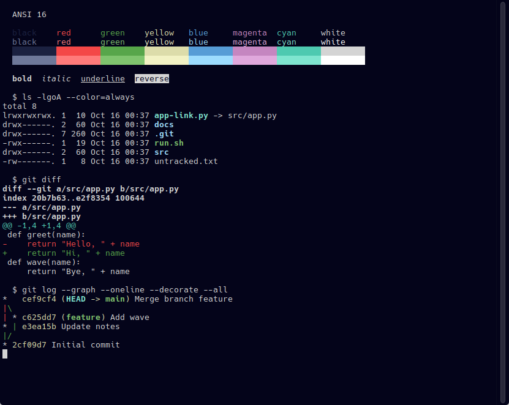

# Deepwick for Konsole

A deep navy terminal color scheme with Visual Studio 2022's syntax colors.

> Deepwick is an unofficial theme derived from
> [Polywick Blue](https://vscode.polywickstudio.net) by Polywick Studio (MIT).
> Not affiliated with Polywick Studio.



## Install

```sh
mkdir -p "${XDG_DATA_HOME:-$HOME/.local/share}/konsole"
cp Deepwick.colorscheme "${XDG_DATA_HOME:-$HOME/.local/share}/konsole/"
```

## Activate

**Settings → Edit Current Profile… → Appearance**, choose **Deepwick**, then
**OK**. To try it without changing a profile:

```sh
konsole -p ColorScheme=Deepwick
```

## Notes

- Bold text in one of the eight standard ANSI colors (SGR 30–37) is drawn in
  that color's bright variant, as Konsole always does. Bold text in the default
  foreground stays Foreground (the intense foreground is not brightened), and
  256-color and truecolor text is never brightened. Faint colors and the
  background use the normal colors.

Tested with Konsole 26.08.1.

## License

MIT. See [LICENSE](LICENSE).
